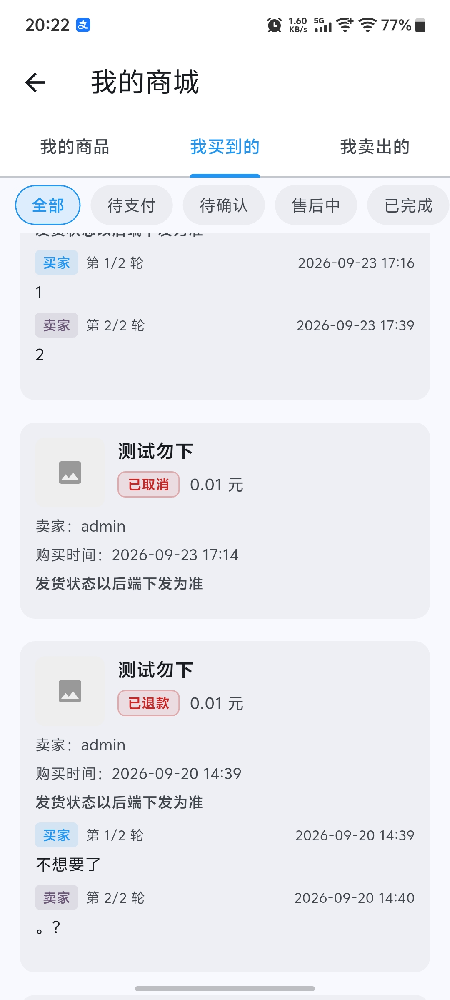

<div align="center">

# ⚡ Fast 社区论坛系统

**FastApi 后端 · Spring Boot 3.5 / JDK 17 · 309 个接口 · 一键部署开箱即用**

[](https://spring.io)
[](https://adoptium.net)
[](https://www.mysql.com)
[](https://redis.io)
[](https://fast.358583.xyz)
[]()
[]()

[安装指南](https://fast.358583.xyz) · [部署文档](./DEPLOYMENT.md) · [API 文档](https://fast.358583.xyz)

</div>

---

## 📖 项目简介

Fast 社区论坛系统（FastApi）是一套基于 Spring Boot 的社区论坛后端，提供 **认证、内容、评论、用户、上传、支付、系统管理** 等 **309 个接口**，覆盖完整社区业务。

**技术栈**

| 分类 | 技术 |
| --- | --- |
| 后端 | Spring Boot 3.5 · JDK 17 |
| 数据库 | MySQL 5.7 · Redis 6.0 |
| 多媒体 | FFmpeg（视频封面） |
| 前端 | FastAppPRO（Flutter） |
| 部署 | Nginx · systemd / crontab |

## ✨ 核心特性

| | 特性 | 说明 |
| :---: | --- | --- |
| 🚀 | **一键安装** | JDK 17 + FFmpeg + 程序 + 配置，脚本自动完成 |
| 🛡️ | **稳定守护** | systemd / crontab 双模式，挂掉自动拉起 |
| 🔄 | **自动备份** | 更新前备份 JAR，失败自动回滚 |
| 📦 | **开箱即用** | 安装完成后域名即 API 地址，直接接入应用 |
| 🗄️ | **内置 JDK** | 不依赖系统 Java，不卸载已有 JDK，避免端口冲突 |
| 🎬 | **视频封面** | 内置 FFmpeg，自动生成视频封面 |

---

## 📋 服务器要求

| 项目 | 最低配置 | 推荐配置 |
| --- | --- | --- |
| CPU / 内存 | 1 核 CPU / 700M 内存 | 2 核 CPU / 2G 内存 |
| 支持系统 | CentOS 7+、Ubuntu、Debian（建议宝塔面板），Windows 也支持 | |
| 架构 | x86_64 | x86_64 / aarch64 |

---

## 🚀 安装部署（4 步完成）

> ⏱️ 全程约 **10 分钟** · 支持 CentOS 7+ / Ubuntu / Debian（建议宝塔面板）

| 步骤 | 内容 | 耗时 |
| :---: | --- | :---: |
| **①** | 前期准备：依赖环境 · 域名 · 端口 | ~3 分钟 |
| **②** | 执行安装脚本：自动装 JDK / FFmpeg / 程序 | ~5 分钟 |
| **③** | 外网访问配置：Nginx 伪静态 | ~2 分钟 |
| **④** | 完成验证：域名即 API 地址 | ~1 分钟 |

---

### ① 前期准备

#### 1️⃣ 安装依赖环境

| 依赖 | 版本 | 说明 |
| --- | --- | --- |
| Typecho | 1.0 / 1.1 / 1.2 | 可选 |
| Redis | 5.0 - 7.0 | 推荐 6.0 |
| MySQL | 5.5 - 5.7 | 推荐 5.6 |

> ⚠️ **重要提醒**
> 请不要在服务器自行安装 Java 和 Tomcat！脚本已内置 JDK 17，自行安装会导致端口冲突。

#### 2️⃣ 准备域名

- **域名 A**：访问 FastApi（必需）
- **域名 B**：访问后台管理（必需）

#### 3️⃣ 规划端口

- 默认运行端口 **8080**，**千万别用 80 或 443**（会被 Nginx/系统占用）
- 确保该端口未被占用、防火墙已放行

---

### ② 执行安装脚本

**第 1 步：下载并运行安装脚本**（支持 CentOS / Ubuntu / Debian）

```bash
cd /opt && (
  wget -O fastapi.sh https://shell.358583.xyz/fastapi.sh 2>/dev/null \
  || curl -o fastapi.sh https://shell.358583.xyz/fastapi.sh
) && chmod +x fastapi.sh && ./fastapi.sh install
```

**第 2 步：脚本自动完成**

> **JDK 17 安装 → FFmpeg 安装 → 程序下载 → 配置生成 → 服务启动**

**第 3 步：按提示输入配置**

| 配置项 | 默认值 | 说明 |
| --- | --- | --- |
| 运行端口 | 8080 | 千万别用 80 或 443 |
| 数据库名 | typecho | 与 Typecho 保持一致 |
| 数据库用户名 | root | 与 Typecho 保持一致 |
| 数据库密码 | （空） | 与 Typecho 保持一致 |
| Redis 密码 | （空） | 一般是空 |
| 系统管理 KEY | 自动生成 | 也叫「访问 Key」，留空自动生成 32 位随机值 |

---

### ③ 外网访问配置

**以宝塔面板为例**

**第 1 步：新建网站** — 新建一个**纯静态网站**，绑定域名 A

**第 2 步：配置 SSL** — 配置 **SSL 证书**（HTTPS）

**第 3 步：配置伪静态** — 将下方代码放入**伪静态**配置：

```nginx
location ^~ / {

    if ( $request_method = 'OPTIONS' ) {
        return 204;
    }

    proxy_pass http://127.0.0.1:8080;
    proxy_set_header Host $host;
    proxy_set_header X-Real-IP $remote_addr;
    proxy_set_header X-Forwarded-For $proxy_add_x_forwarded_for;
    proxy_set_header REMOTE-HOST $remote_addr;
}
```

**第 4 步：修改端口** — 将上方 `8080` 替换为第二步设置的 API 端口

**第 5 步：完成安装** — 访问域名，key 登录，点击「**安装及更新**」完成安装

**第 6 步：Typecho 提示** — 如果未安装 Typecho，将弹出提示询问是否需要独立安装

---

### ④ 安装完成

🎉 恭喜！FastApi 安装完成。

> 你使用的域名即为 **API 接口地址**，可直接接入你的应用。

**验证服务状态**

```bash
sh /opt/fastapi.sh status    # 查看运行状态与资源占用
sh /opt/fastapi.sh logs -f   # 实时查看运行日志
```

---

## 🛠️ 常用命令

```bash
sh /opt/fastapi.sh install          # 首次安装
sh /opt/fastapi.sh start            # 启动
sh /opt/fastapi.sh stop             # 停止
sh /opt/fastapi.sh restart          # 重启
sh /opt/fastapi.sh status           # 状态与资源占用
sh /opt/fastapi.sh update           # 更新（自动备份，失败回滚）
sh /opt/fastapi.sh logs -f          # 实时日志
sh /opt/fastapi.sh monitor          # 单次守护检测（crontab 用）
sh /opt/fastapi.sh service install  # 安装 systemd 开机自启
```

完整命令、环境变量、守护配置、更新回滚、API 对接须知见 [DEPLOYMENT.md](./DEPLOYMENT.md)。

---

## 🔗 相关链接

| 资源 | 地址 |
| --- | --- |
| 🌐 安装指南 | https://fast.358583.xyz |
| 📜 管理脚本下载 | https://shell.358583.xyz/fastapi.sh |
| 📦 程序包下载 | https://shell.358583.xyz/FastApi.jar |
| 🔌 API 接口地址 | 你的部署域名（如 https://api.358583.xyz） |

---

## 📱 前端应用 · FastAppPRO

FastAppPRO 是基于 **Flutter** 开发的 Android 客户端，完整对接 FastApi 后端接口，涵盖社区、商城、消息、道具等模块。

| 首页 | 商城中心 | 帖子详情 |
| --- | --- | --- |
|  |  |  |

| 我的商城 | 我买到的 | 道具中心 |
| --- | --- | --- |
|  |  |  |

| 消息中心 | 官方公告 | 头像挂件 |
| --- | --- | --- |
|  |  |  |
